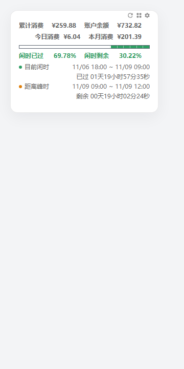
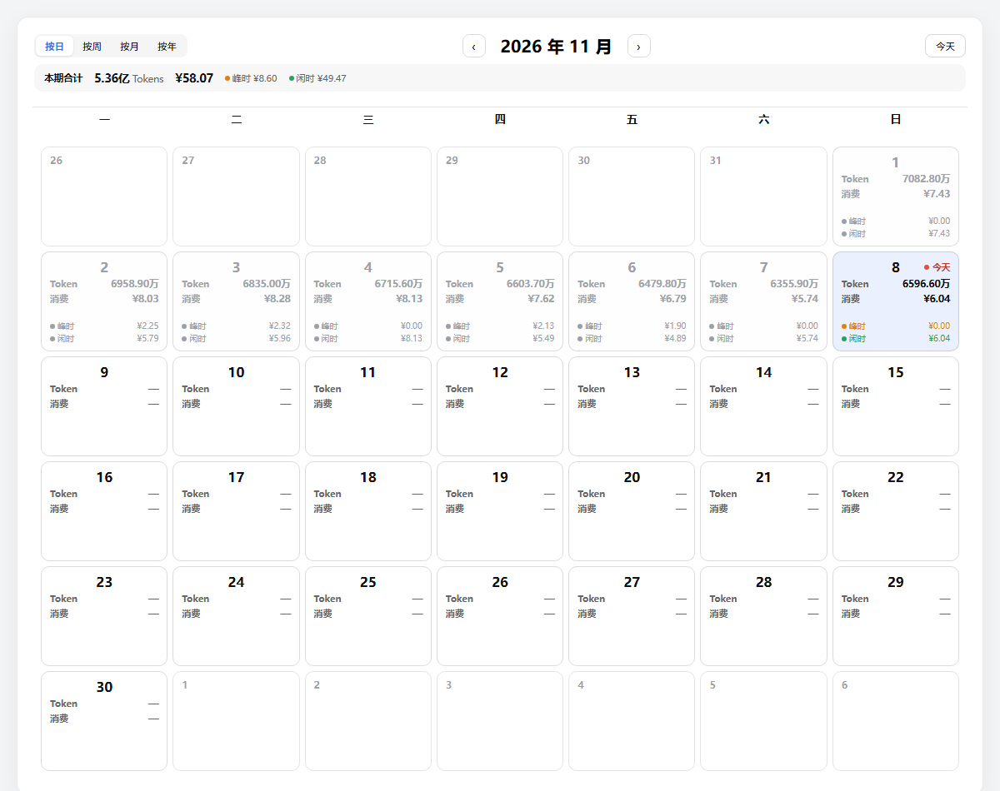
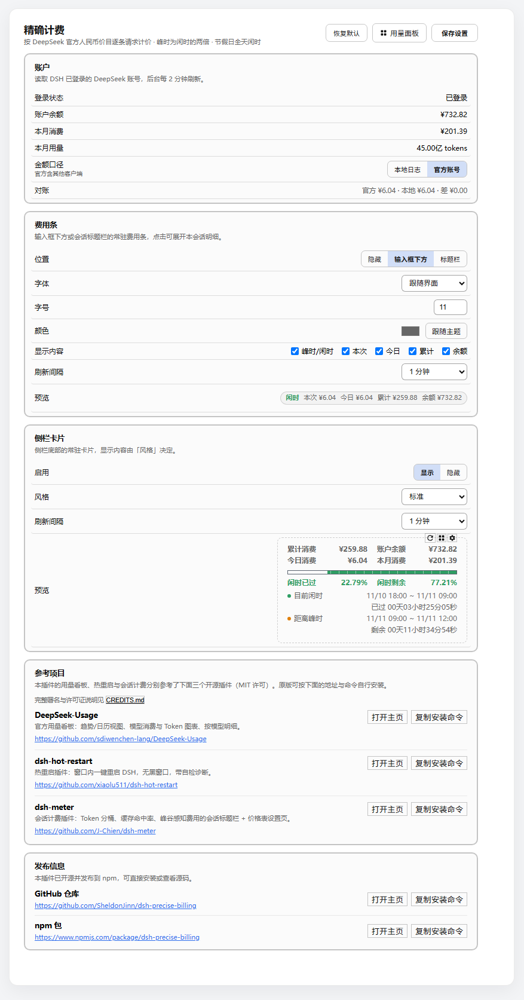
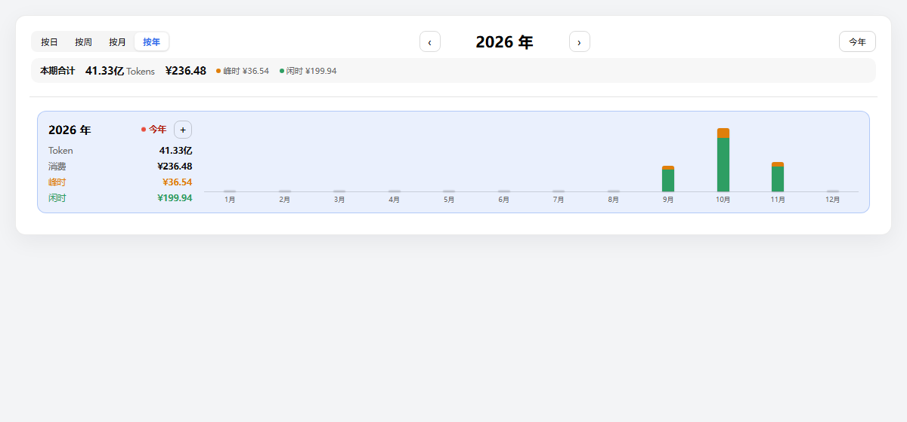
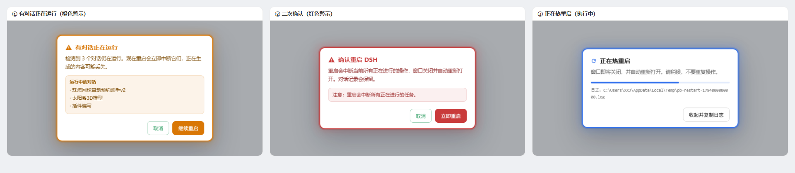

# 精确计费（precise-billing）

> 按 DeepSeek 官方人民币价目（含峰谷时段与法定节假日）**逐条请求**精确计算会话费用，并提供费用条、侧栏卡片、用量看板与一键热重启。

- **作者**：Sheldon Jinn
- **版本**：0.2.0
- **包名**：`@local/precise-billing`
- **类型**：DSH 本地插件（Host + Client）

## 界面预览

**侧栏卡片**



**用量日历（按日）**



**设置页**



**年视图（当前年份高亮）**



**热重启（三段式：警示 → 确认 → 执行）**



## 功能

### 1. 精确计费

- 以每条 `assistant/message` 自带的 `usage` 为计价单位，而不是估算；
- 按**该请求自己的时间戳**判定峰谷：北京时间 09:00–12:00、14:00–18:00，且为周一至周五；
- 内置 2025–2026 中国法定节假日，节假日全天按闲时；
- 输入（未命中缓存）、缓存命中、缓存写入、输出四个通道分别按单价计算；
- 峰时单价 = 闲时单价 × 2（与官方一致）；
- 未定价模型单独计数并在界面上标注「未计价」，不会伪装成 0 元。

| 模型 | 输入（未命中） | 缓存命中 | 输出 |
| --- | --- | --- | --- |
| deepseek-flash（含 v4-flash） | ¥1 / ¥2 | ¥0.02 / ¥0.04 | ¥4 / ¥8 |

> 上表为「人民币 / 百万 token，闲时 / 峰时」。

### 2. 费用条

- 位置可选：输入框下方 / 会话标题栏 / 隐藏；
- 显示内容可勾选：峰时/闲时、本次、今日、累计、余额；
- 字体、字号、颜色可调，支持跟随主题；
- 点击费用条可展开本会话明细。

### 3. 侧栏卡片

- 常驻侧栏底部，显示今日消费、累计消费、账户余额与峰谷进度；
- 风格：标准 / 简约 / 紧凑 / 自定义；
- 自定义可逐项控制 16 个显示项（顶部金额、进度条、百分比、时段明细）；
- 右上角两个灰色图标：**热重启**、**用量看板**，再右侧是设置齿轮。

### 4. 用量看板

- **趋势**：统计卡（Token、请求、消费、余额）、各模型消费金额（趋势 / 综合）、各模型 Token 用量、API 请求次数曲线、各模型明细与环比；
- 单日按小时、多日按天、超过 120 天自动按月聚合；
- **日历**：日 / 周 / 月 / 年四种视图；每格显示 Token、消费、峰时/闲时金额；
- 当前日期/周/月/年带红点与「今天/本周/本月/今年」标记；
- 未选中的格子淡灰、悬停变亮；周行之间有分隔线与整行悬停；
- 点击日期弹出详情（消费、峰时/闲时、请求、输入命中/未命中、缓存写入、输出、Token 合计、分模型）；
- 年视图：每年一行，左侧汇总 + 右侧 12 个月柱状图（峰时/闲时堆叠颜色），悬停月份显示详情，可展开 12 个月卡片。

### 5. 一键热重启

- 侧栏卡片右上角刷新图标触发；
- **三段式流程**：
  1. 先检查是否有对话在运行：有则弹**橙色警示框**列出运行中的对话，用户可选择「继续重启」；
  2. 再弹**红色确认框**，明确提示会中断进行中的操作（取消按钮为绿色）；
  3. 确认后进入**执行中**弹窗（蓝色进度条 + 日志路径）；
- 警示框使用 **2.5px 彩色实线边框 + 柔和呼吸光晕**（橙色=有对话运行，红色=最终确认），标题与正文跟随边框同色；支持减少动态效果的系统设置；\n- 确认后由宿主侧助手完成「结束进程 → 自动重新拉起」，全程无黑窗口；
- 重启前会做**环境快照**（`DSH_*` 与代理变量），保证重开后环境一致；
- 每次重启写入日志 `%TEMP%\pb-restart-<时间戳>.log`，弹窗中可直接「收起并复制日志」拿到路径。

### 6. 设置

- 所有选项**自动保存**（600ms 防抖），保存后页面中央弹出✓提示；
- 「恢复默认」立即保存默认值；
- 默认刷新间隔统一为 **60 秒**；
- 进度条关闭时，刻度线/游标/悬浮提示自动禁用；重新开启时自动恢复勾选；
- 自定义显示项至少保留一个。

## 安装

本插件为本地插件，按 DSH 的本地 link 方式安装：

```bash
dsh plugin --profile desktop add link:C:\Users\XXJ\Documents\deepseek-harness\default-workspace\_plugins\precise-billing
```

安装后在 设置 → 插件 中启用，并刷新页面。

## 数据位置

- 索引与设置：`$DSH_HOME/storages/precise-billing.json`
- 会话源数据：`$DSH_HOME/sessions/**/session.v4.jsonl.zstd`（只读）
- 重启日志：`%TEMP%\pb-restart-*.log`
- 仓库备份：`E:\DSH项目备份\插件编写\插件编写.git`

## 参考项目

本插件的用量看板与热重启功能分别参考了下面两个开源插件（均为 MIT 许可），代码为独立实现，未逐行复制。

### DeepSeek-Usage

官方用量看板：趋势 / 日历视图、模型消费与 Token 图表、按模型明细。

- 地址：<https://github.com/sdiwenchen-lang/DeepSeek-Usage>
- 下载 / 安装：`dsh plugin --profile desktop add deepseek-usage`

[前往 GitHub 下载](https://github.com/sdiwenchen-lang/DeepSeek-Usage) · [npm 页面](https://www.npmjs.com/package/deepseek-usage)

### dsh-hot-restart

热重启插件：窗口内一键重启 DSH，无黑窗口，带自检诊断。

- 地址：<https://github.com/xiaolu511/dsh-hot-restart>
- 下载 / 安装：`dsh plugin --profile desktop add dsh-hot-restart`

[前往 GitHub 下载](https://github.com/xiaolu511/dsh-hot-restart) · [npm 页面](https://www.npmjs.com/package/dsh-hot-restart)

> 更多说明见仓库内 `CREDITS.md`；设置页底部「参考项目」也提供了一键打开主页与复制安装命令。

## 更新日志

### 0.2.0

- 新增：用量看板（趋势 + 日历日/周/月/年、模型图表、日期详情、年视图柱状图）；
- 新增：两段式热重启确认、环境快照、预检与重启日志；
- 新增：设置自动保存与提示；
- 新增：参考项目说明与安装入口；
- 调整：默认刷新间隔统一为 60 秒；按钮与图标样式统一。

### 0.1.0

- 首个版本：逐条请求计价、费用条、侧栏卡片、设置页。

## 作者

Sheldon Jinn
